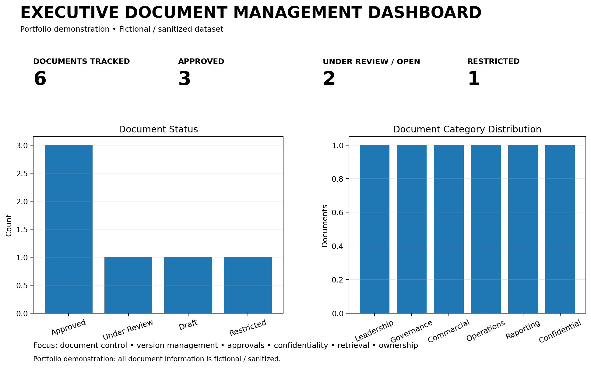

# Executive Document Management

## Kiran Kumar Ambati

**Senior Executive Assistant | Executive Office | Document Control & Information Management**

A professional portfolio demonstrating structured executive document management, document intake, classification, version control, review and approval tracking, secure information handling, document retrieval and management visibility.

---

## Executive Document Management

Effective document management requires more than storing files. It requires clear ownership, accurate version control, appropriate access, timely review, reliable retrieval and disciplined records management.

### Core Responsibilities

| Area | Approach |
|---|---|
| Document Intake | Capture incoming documents and identify required action |
| Classification | Categorize documents according to business purpose and sensitivity |
| Version Control | Maintain accurate versions and prevent outdated copies from being used |
| Review Coordination | Track reviewers, due dates and pending inputs |
| Approval Tracking | Monitor approvals and maintain final approved versions |
| Access Management | Handle confidential and restricted information appropriately |
| Document Register | Maintain searchable visibility of key documents |
| Retrieval | Enable quick access to current and approved records |
| Retention | Maintain records according to organizational requirements |
| Follow-Up | Track outstanding document actions and deadlines |

---

## Executive Document Operating Model

**Receive → Classify → Register → Review → Approve → Secure → Retrieve → Retain**

1. **Receive** — Capture documents and identify the required action.
2. **Classify** — Assign document type, business category and sensitivity.
3. **Register** — Record owner, version, dates, status and location.
4. **Review** — Coordinate stakeholders and track review deadlines.
5. **Approve** — Capture approval status and maintain the final approved version.
6. **Secure** — Apply appropriate confidentiality and access controls.
7. **Retrieve** — Ensure current records can be located quickly.
8. **Retain** — Maintain appropriate records for future reference and auditability.

---

## Document Management Dashboard

> **Portfolio demonstration:** The dashboard uses fictional / sanitized data.

## Files

- `document-register.csv` — sample executive document register
- `document-tracker.csv` — sample review, approval and action tracker
- `document-management-dashboard.png` — visual portfolio dashboard

## Tools & Working Methods

Microsoft Excel | Microsoft Outlook | Microsoft Teams | SharePoint | Document Control | Version Management | Records Management | Confidential Information Handling | Action Tracking | Stakeholder Coordination
